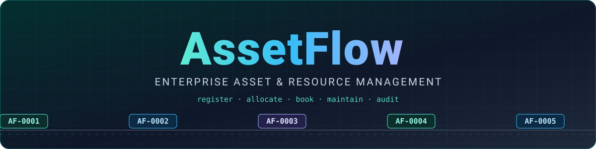
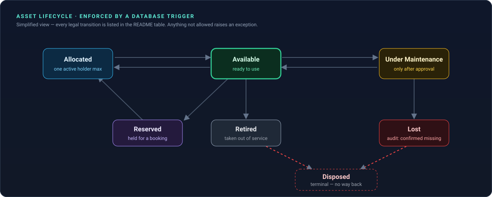
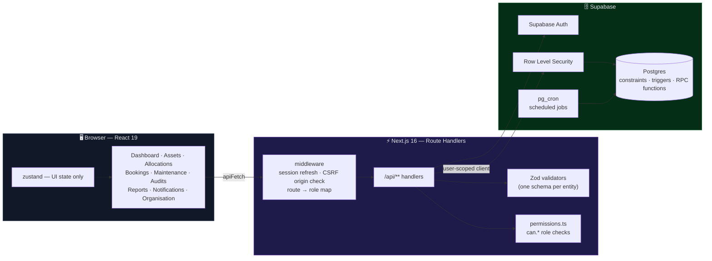
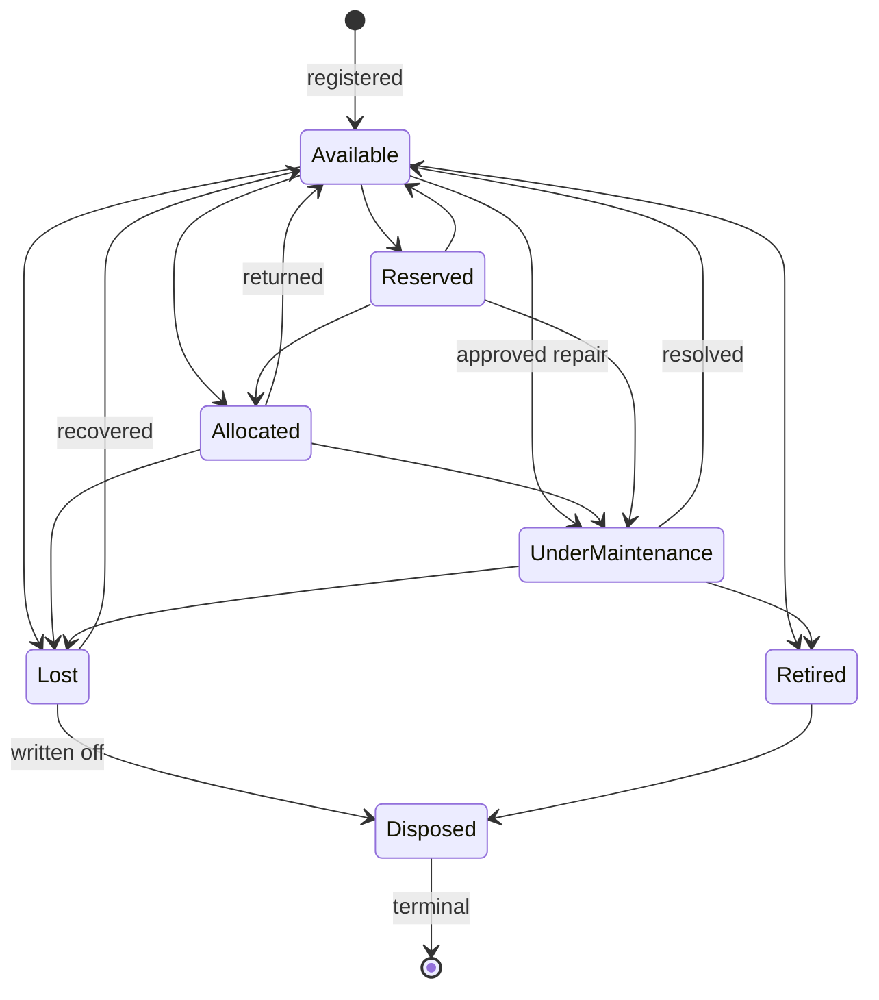
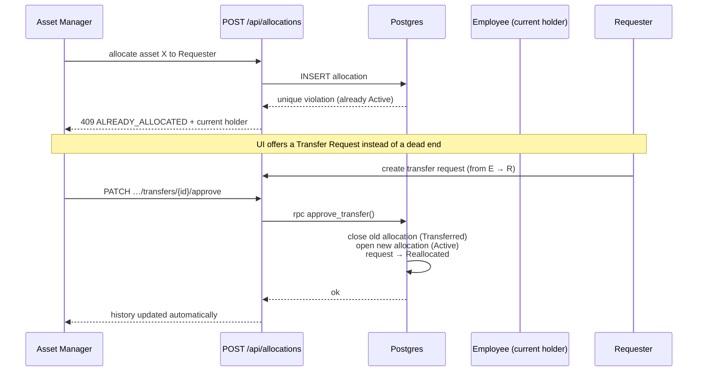
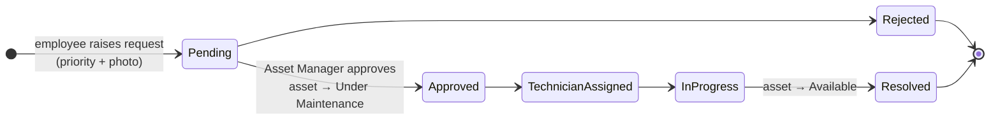
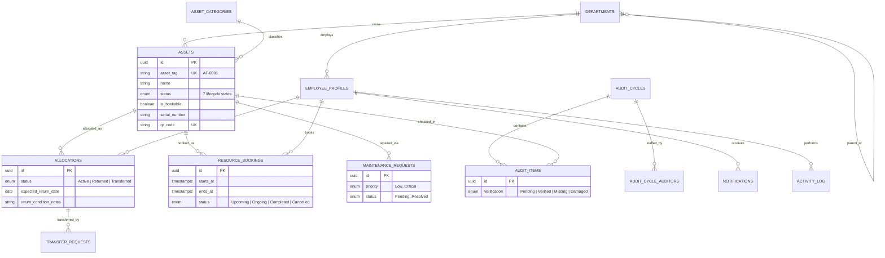

<div align="center">



<br/>

[](#-tech-stack)
[](#-tech-stack)
[-3ecf8e?style=flat-square)](#-data-model)
[](#-security--access-control)
[](#-rules-the-database-enforces)
[](#-notifications-activity-log--scheduled-jobs)
[](#-tech-stack)
[](#-about-this-project)

**Track every physical asset from purchase to disposal. Allocate without double-booking. Book shared resources without overlap. Approve maintenance before anything breaks the lifecycle. Audit with a paper trail — and let the database, not the UI, guarantee all of it.**

</div>

---

## What is AssetFlow?

AssetFlow is a **centralised ERP-style platform for managing an organisation's physical assets and shared resources** — offices, schools, hospitals, factories, anyone with laptops, vehicles, projectors and meeting rooms to keep track of. It replaces spreadsheets and "who has the camera?" messages with a single system covering the whole asset journey:

1. **Set up the organisation** — a department hierarchy, asset categories with custom fields, and an employee directory with controlled role promotion.
2. **Register assets** with auto-generated tags (`AF-0001`, `AF-0002`, …), serial numbers, condition, location, photos and QR codes, searchable across tag, name and serial.
3. **Allocate and transfer** — an asset can have exactly **one** active holder. Try to allocate a held asset and you're shown *who has it* and offered a **transfer request** instead of a dead-end error.
4. **Book shared resources** on a calendar, with overlapping time slots **rejected by the database itself**.
5. **Run maintenance through an approval workflow** — an asset only flips to *Under Maintenance* after a manager approves, and only returns to *Available* when the work is resolved.
6. **Audit on a schedule** — scoped audit cycles with assigned auditors who mark each asset *Verified*, *Missing* or *Damaged*; closing a cycle locks the results and writes off what's missing.
7. **See everything** — KPI dashboard, utilisation, maintenance-frequency and booking-heatmap reports, notifications, and a complete activity log.

Out of scope **by design**: purchasing, invoicing and accounting. Acquisition cost is stored purely for reporting and ranking, never tied to any financial logic.

<br/>

<div align="center">

<sub>Animated in a browser (GitHub renders raw SVG natively) — packets travel the legal transitions. Illegal ones are rejected by a Postgres trigger, whatever the client sends.</sub>
</div>

---

## Table of Contents

- [Why This Exists](#why-this-exists)
- [Architecture at a Glance](#-architecture-at-a-glance)
- [Roles & Permissions](#-roles--permissions)
- [Rules the Database Enforces](#-rules-the-database-enforces)
- [Asset Lifecycle](#-asset-lifecycle)
- [Allocation & Transfers](#-allocation--transfers)
- [Resource Booking](#-resource-booking)
- [Maintenance Workflow](#-maintenance-workflow)
- [Audit Cycles](#-audit-cycles)
- [Reports & Analytics](#-reports--analytics)
- [Notifications, Activity Log & Scheduled Jobs](#-notifications-activity-log--scheduled-jobs)
- [Security & Access Control](#-security--access-control)
- [Data Model](#-data-model)
- [API Surface](#-api-surface)
- [Tech Stack](#-tech-stack)
- [Getting Started](#-getting-started)
- [Configuration Reference](#-configuration-reference)
- [Project Layout](#-project-layout)
- [Roadmap](#-roadmap)
- [About This Project](#-about-this-project)

---

## Why This Exists

Asset tracking fails in boring, predictable ways: two people both "have" the same laptop, the meeting room is double-booked, a broken projector is still listed as available, and the annual stock-take turns into an argument. Most of those aren't UI problems — they're **integrity problems** that appear when rules live only in front-end code or in people's heads.

AssetFlow's central design decision is to put the rules where they can't be bypassed:

- **Integrity** — double allocation, overlapping bookings, illegal status jumps and edits to closed audits are impossible at the **database** level, not merely discouraged by the UI.
- **Accountability** — every state-changing action appends to an activity log with who, what and when.
- **Least privilege** — four roles, enforced by route handlers *and* Row Level Security, with no way to self-assign a role.
- **Workflow, not just records** — transfers, maintenance and audits are real multi-step approvals with defined owners, not free-text status fields.

---

## 🏗 Architecture at a Glance

One **Next.js App Router** codebase serves both the UI and the API (Route Handlers). All persistence, auth and scheduled work live in **Supabase**; the browser never talks to the database directly for writes.



**Server state comes from the API, not from global client stores** — zustand holds only sidebar and modal state, and every list and mutation goes through a route handler so validation, permissions and logging happen in one place.

---

## 👥 Roles & Permissions

| Capability | 🛡 Admin | 🧰 Asset Manager | 🏛 Dept. Head | 👤 Employee |
|---|:---:|:---:|:---:|:---:|
| Manage departments, categories, employee directory | ✅ | ❌ | ❌ | ❌ |
| Promote an employee to Asset Manager / Dept. Head | ✅ | ❌ | ❌ | ❌ |
| Register / edit assets, change asset status | ✅ | ✅ | ❌ | ❌ |
| Allocate an asset | ✅ | ✅ | ❌ | ❌ |
| Approve or reject transfer requests | ✅ | ✅ | ✅ | ❌ |
| Request a transfer for an asset they hold | ✅ | ✅ | ✅ | ✅ |
| Book a shared resource | ✅ | ✅ | ✅ | ✅ |
| Cancel a booking | own + any | own + any | own + any | own only |
| Raise a maintenance request | ✅ | ✅ | ✅ | ✅ |
| Approve maintenance | ✅ | ✅ | ❌ | ❌ |
| Create / close audit cycles | ✅ | ✅ | ❌ | ❌ |
| Verify audit items | ✅ | ✅ | assigned auditors only | assigned auditors only |
| View reports & analytics | ✅ | ✅ | ✅ | ❌ |

> **Signup is Employee-only.** There is no role picker anywhere at registration — a database trigger always creates the profile as `Employee`. Promotion to Department Head or Asset Manager happens in exactly one place: **Organisation Setup → Employee Directory**, performed by an Admin.

---

## 🔒 Rules the Database Enforces

This is the heart of the project. Each rule below would be easy to get subtly wrong in application code; here each one is backed by a Postgres mechanism that holds even if a buggy client, a second API, or a direct query tries to break it.

| Business rule | Enforced by |
|---|---|
| **An asset has at most one active allocation** | Partial unique index `uidx_one_active_allocation_per_asset` on `allocations(asset_id) WHERE status = 'Active'` |
| **No overlapping bookings for a resource** (touching ranges are fine) | `EXCLUDE USING gist` on `(resource_asset_id, tstzrange(starts_at, ends_at, '[)'))` for `Upcoming`/`Ongoing` bookings |
| **Booking must end after it starts** | `CHECK (ends_at > starts_at)` |
| **Only legal lifecycle transitions** | `BEFORE UPDATE OF status` trigger `validate_asset_status_transition()` |
| **Maintenance flips asset status only at the right moments** | Trigger `sync_asset_status_on_maintenance()` — `Approved` → *Under Maintenance*, `Resolved` → *Available* |
| **Approving a transfer is atomic** | `approve_transfer()` function: closes the old allocation, opens the new one, marks the request `Reallocated` — in one transaction, under a row lock |
| **Closing an audit is final** | `close_audit_cycle()` writes confirmed-missing assets to *Lost* and locks the cycle; trigger `prevent_edit_after_close()` blocks later edits to its items |
| **An allocation needs a holder** | `CHECK (employee_id IS NOT NULL OR department_id IS NOT NULL)` |
| **Asset tags are unique and sequential** | `asset_tag_seq` default → `AF-0001`, `AF-0002`, … |
| **Roles can't be self-assigned** | `handle_new_user()` trigger hard-codes `Employee`; RLS blocks non-admins from changing roles |
| **Brute-force lockout** | `is_login_locked_out()` — 5 failed attempts in 15 minutes |

Route handlers translate these database errors into friendly responses — a unique violation on allocation becomes a `409 ALREADY_ALLOCATED` carrying the current holder, and a booking exclusion violation becomes `409 SLOT_CONFLICT`.

---

## 🔄 Asset Lifecycle

Status changes go through one validated gate. A client can't `PATCH` an arbitrary string — the trigger checks the transition against this matrix:



| From | May move to |
|---|---|
| **Available** | Allocated · Reserved · Under Maintenance · Lost · Retired |
| **Allocated** | Available · Under Maintenance · Lost |
| **Reserved** | Available · Allocated · Under Maintenance |
| **Under Maintenance** | Available · Retired · Lost |
| **Lost** | Available · Disposed |
| **Retired** | Disposed |
| **Disposed** | *(terminal)* |

---

## 📦 Allocation & Transfers

The interesting case isn't a successful allocation — it's the **conflict**. Instead of a generic error, AssetFlow turns it into a workflow:



- **Check-in flow** — returning an asset records the **return condition notes** and closes the allocation.
- **Allocate to a person or a department** — an allocation can target either, with an optional expected return date.
- **Transfer states** — `Requested → Approved/Rejected → Reallocated`; approvers are Asset Managers, Department Heads and Admins.

---

## 📅 Resource Booking

Shared resources are assets flagged `is_bookable`. Employees pick a time slot on a **calendar view**, and the booking is validated **server-side and authoritatively** — the calendar is a convenience, never the source of truth.

- Overlap detection is a Postgres **exclusion constraint** over time ranges, so two requests racing for the same slot can't both win.
- Ranges are half-open (`[start, end)`): a booking that starts exactly when another ends is valid.
- Bookings can be **cancelled** or **rescheduled**, and the status rolls `Upcoming → Ongoing → Completed` automatically via a scheduled job.
- A department can be recorded as the party the booking is made for.

---

## 🛠 Maintenance Workflow



Priorities are **Low / Medium / High / Critical**. The asset's status never changes on request — only on approval — so a flood of speculative tickets can't take assets out of circulation. Each asset keeps a full maintenance history.

---

## 🔎 Audit Cycles

| Step | What happens |
|---|---|
| **Scope** | Create a cycle for a department and/or location and a date range |
| **Assign** | Pick the auditors; assets in scope become audit items |
| **Verify** | Each item is marked **Verified**, **Missing** or **Damaged** by an assigned auditor (or an Asset Manager/Admin) |
| **Review** | A discrepancy report lists everything that isn't *Verified* |
| **Close** | One final action: confirmed-missing assets flip to **Lost**, the cycle locks, and further edits are rejected by trigger |

---

## 📊 Reports & Analytics

Reports are computed in the database by dedicated SQL functions, so they stay fast and consistent with the live data:

| Report | Function | Answers |
|---|---|---|
| **Utilisation by department** | `report_utilization_by_department(from, to)` | Which departments hold the most active assets? |
| **Maintenance frequency** | `report_maintenance_frequency(from, to)` | Which assets keep breaking, and how long do fixes take? |
| **Booking heatmap** | `report_booking_heatmap(from, to)` | When are shared resources busiest? |
| **Due for attention** | `report_due_for_attention()` | What needs maintenance or follow-up soon? |

The **dashboard** adds KPI cards (available / allocated / reserved assets, active bookings, pending transfers, overdue returns), a recent-activity feed, and a personal "mine" panel with the user's own allocations, bookings and maintenance requests. Overdue detection is computed **server-side** from expected return dates, never just a UI label.

---

## 🔔 Notifications, Activity Log & Scheduled Jobs

**Notifications** cover: asset assigned, maintenance approved/rejected, booking confirmed/cancelled/reminder, transfer approved, overdue-return alert, and audit discrepancy flagged — with per-user read state.

**Activity log** — every state-changing action calls `log_activity(actor, action, entity_type, entity_id, metadata)`, producing entries like `allocation.created` or `maintenance.approved`, queryable by entity, actor or time.

**Scheduled jobs** (`pg_cron`, in `supabase/post-deploy/cron.sql`):

| Job | Schedule | Does |
|---|---|---|
| `flag-overdue-allocations` | every 15 min | Notifies holders of overdue returns — **idempotent**, one alert per allocation |
| `roll-booking-status` | every 5 min | Moves bookings `Upcoming → Ongoing → Completed` by the clock |
| `booking-reminders` | daily, 08:00 | Notifies users of bookings starting within the next hour |

---

## 🔐 Security & Access Control

- **Defence in depth** — a request is checked by middleware (session + route-to-role map), by the route handler (`can.*` permission helpers + Zod validation), and finally by **Row Level Security** in Postgres.
- **RLS everywhere** — all 12 core tables have RLS enabled: directories are readable by any signed-in user, while writes are limited by role (e.g. only Admins write departments and categories; only Admins/Asset Managers write assets and allocations; employees see their own and their department's allocations).
- **No self-service privilege escalation** — signup creates an `Employee`; non-admins cannot modify roles through RLS.
- **Brute-force protection** — failed logins are recorded with IP, and 5 failures in 15 minutes lock the email out with a `429`.
- **Deactivated accounts are blocked** at login (`status = 'Inactive'`) and ignored by every permission check.
- **CSRF defence** — state-changing `/api/**` requests from a foreign `Origin` are rejected, on top of `SameSite=Lax` cookies.
- **Secrets stay server-side** — the service-role key is used only by seeding/cleanup scripts, never shipped to the browser.

---

## 🗄 Data Model



Supporting tables: `login_attempts` (lockout), plus the helper functions `set_updated_at`, `current_employee`, `log_activity`, `approve_transfer`, `close_audit_cycle`, and the reporting functions. Search across tag, name and serial number uses a **GIN full-text index**, and the schema ships as 13 ordered migrations.

---

## 🔌 API Surface

All routes live under `app/api` as Route Handlers and return JSON; errors use a consistent `{ error }` shape.

| Area | Routes |
|---|---|
| **Auth** | `POST /auth/signup` · `POST /auth/login` · `POST /auth/logout` · `GET /auth/session` · `POST /auth/forgot-password` |
| **Employees** | `GET /employees` · `PATCH /employees/{id}` · `PATCH /employees/{id}/promote` |
| **Organisation** | `GET/POST /departments` · `GET/PATCH /departments/{id}` · `GET/POST /categories` |
| **Assets** | `GET/POST /assets` · `GET/PATCH /assets/{assetId}` · `PATCH …/status` · `GET …/history` |
| **Allocations** | `GET/POST /allocations` · `POST …/{id}/return` |
| **Transfers** | `GET/POST /allocations/transfers` · `PATCH …/{id}/approve` · `PATCH …/{id}/reject` |
| **Bookings** | `GET/POST /bookings` · `POST …/{id}/cancel` · `PATCH …/{id}/reschedule` |
| **Maintenance** | `GET/POST /maintenance` · `POST …/{id}/approve` · `POST …/assign` · `PATCH …/start` · `POST …/resolve` |
| **Audits** | `GET/POST /audits` · `GET /audits/{id}` · `POST …/{id}/verify` · `POST …/{id}/close` |
| **Reports** | `GET /reports` · `…/utilization` · `…/maintenance-frequency` · `…/booking-heatmap` · `…/due-for-maintenance` |
| **Dashboard & feed** | `GET /dashboard/summary` · `GET /activity-log` · `GET /notifications` · `PATCH /notifications/{id}/read` |

List endpoints paginate (default page size 25, capped at 100) and accept filters such as `status`, `departmentId`, `assetId`, and `mine=true`.

---

## 🛠 Tech Stack

| Layer | Technology |
|---|---|
| **Framework** | Next.js 16 (App Router, Route Handlers) · React 19 · TypeScript |
| **UI** | Tailwind CSS v4 · shadcn/ui on Base UI · Lucide icons · Sonner toasts |
| **Forms & validation** | react-hook-form · Zod (one schema per entity) |
| **State** | Zustand (UI state only) · date-fns |
| **Backend** | Supabase — Postgres, Auth, Row Level Security, `pg_cron` |
| **Database logic** | PL/pgSQL triggers & functions · exclusion constraints (`btree_gist`) · partial unique indexes · GIN full-text search |
| **Tooling** | ESLint 9 · `tsx` seed/cleanup scripts · generated Supabase types |

---

## 🚀 Getting Started

**Prerequisites:** Node.js 20+, a Supabase project, and the Supabase CLI (`npx supabase`).

```bash
git clone https://github.com/Sp2736/asset-flow.git
cd asset-flow
npm install
cp .env.example .env.local        # fill in your Supabase keys (see below)

# 1 — link and push the schema (tables, triggers, functions, RLS)
npx supabase login
npx supabase link --project-ref <your-project-ref>
npx supabase db push

# 2 — enable pg_cron (Dashboard → Database → Extensions), then run:
#     supabase/post-deploy/cron.sql

# 3 — seed demo data and demo users
npx supabase db execute -f supabase/seed.sql
npx tsx scripts/seed-test-users.ts

# 4 — (optional) regenerate TypeScript types
npx supabase gen types typescript --project-id <your-project-ref> > src/types/database.types.ts

npm run dev                        # http://localhost:3000
```

The seed creates **6 departments** (including a sub-department and an inactive one), **6 categories**, and demo assets, allocations, transfers, bookings, maintenance requests, an audit cycle, notifications and activity — plus **12 demo users** across all four roles, so every screen has something to show on first login. See `scripts/seed-test-users.ts` for the demo logins.

> **Note:** `scripts/cleanup.ts` removes seeded users. Both scripts use the **service-role key** — run them locally only, and never commit that key.

---

## 🔧 Configuration Reference

| Variable | Purpose |
|---|---|
| `NEXT_PUBLIC_SUPABASE_URL` | Supabase project URL |
| `NEXT_PUBLIC_SUPABASE_ANON_KEY` | Public anon key used by the browser/server clients (RLS applies) |
| `SUPABASE_SERVICE_ROLE_KEY` | **Server/scripts only** — bypasses RLS; used for seeding and cleanup |
| `NEXT_PUBLIC_SITE_URL` | Canonical site URL — used for the CSRF origin check and password-reset redirects |

---

## 📁 Project Layout

```
asset-flow/
├── src/
│   ├── app/
│   │   ├── (auth)/              # login · signup · forgot-password
│   │   ├── (dashboard)/         # dashboard · assets · allocations · bookings
│   │   │                        # maintenance · audits · reports · notifications · organization
│   │   └── api/                 # Route Handlers — one folder per resource
│   ├── components/
│   │   ├── assets/ allocations/ bookings/ maintenance/ audits/
│   │   ├── organization/ dashboard/ notifications/
│   │   ├── layout/              # Sidebar · Topbar · AuthGuard · RoleGate
│   │   └── ui/                  # shadcn primitives
│   ├── lib/
│   │   ├── supabase/            # browser · server · admin clients
│   │   ├── validators/          # Zod schema per entity
│   │   ├── permissions.ts       # can.* role helpers
│   │   ├── auth-context.ts      # current user + profile
│   │   └── api-response.ts      # error → HTTP mapping (incl. Postgres codes)
│   ├── hooks/ store/ types/
│   └── middleware.ts            # session refresh · CSRF · route role map
├── supabase/
│   ├── migrations/              # 0001 … 0013 — schema, triggers, RLS, reports
│   ├── post-deploy/cron.sql     # pg_cron jobs
│   └── seed.sql
├── scripts/                     # seed-test-users.ts · cleanup.ts
├── instructions/                # build notes: schema, auth, backend, integration
├── AGENTS.md                    # product rules & conventions for AI coding agents
└── public/details/              # Excalidraw design source
```

---

## 🗺 Roadmap

- [x] Role model with Employee-only signup and admin-only promotion
- [x] Asset registry with auto tags, full-text search and lifecycle trigger
- [x] Allocation conflict handling with transfer workflow
- [x] Exclusion-constraint booking engine with calendar, cancel and reschedule
- [x] Maintenance approval workflow
- [x] Scoped audit cycles with close-and-lock
- [x] RLS on every table, login lockout, CSRF origin check
- [x] Reporting functions, dashboard KPIs, notifications and activity log
- [x] `pg_cron` jobs for overdue alerts and booking status
- [ ] Run booking reminders more often than once a day so mid-day slots are covered
- [ ] Remove the duplicate no-op `middleware.ts` at the repo root (the active one is `src/middleware.ts`)
- [ ] Drop debug file writes from the login handler
- [ ] Exportable report downloads (CSV / PDF)
- [ ] QR-code generation and scan-to-lookup in the asset directory
- [ ] Automated tests for the database rules (allocation conflict, booking overlap, audit lock)

---

## 📄 About This Project

AssetFlow was built for the **Odoo Hackathon (July 2026)** — an 8-hour online format — as a full-stack ERP-style module. The brief valued correctness of real business rules over surface polish, which is why so much of the logic lives in constraints, triggers and functions rather than in UI code. The design mockup source is included under `public/details/`.

<div align="center">
<sub>Rules in the database. Workflow in the API. Clarity in the UI.</sub>
</div>